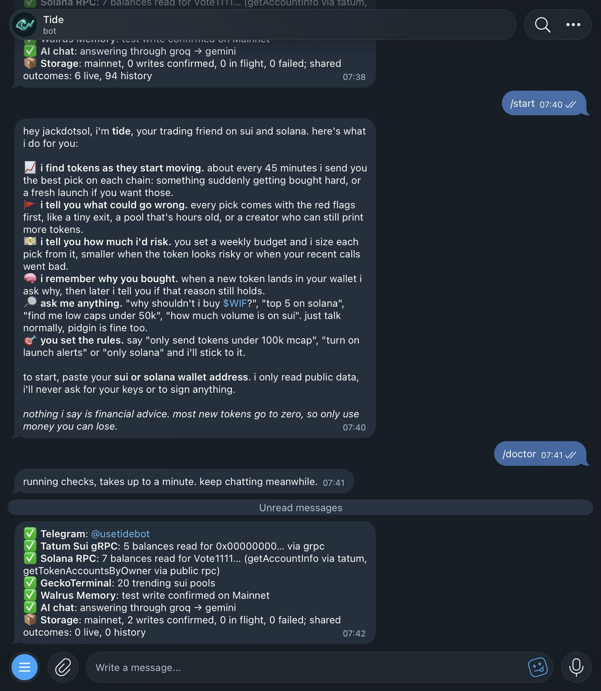
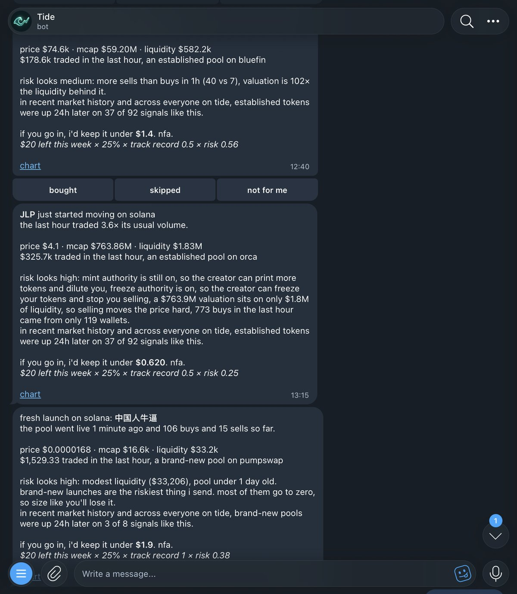
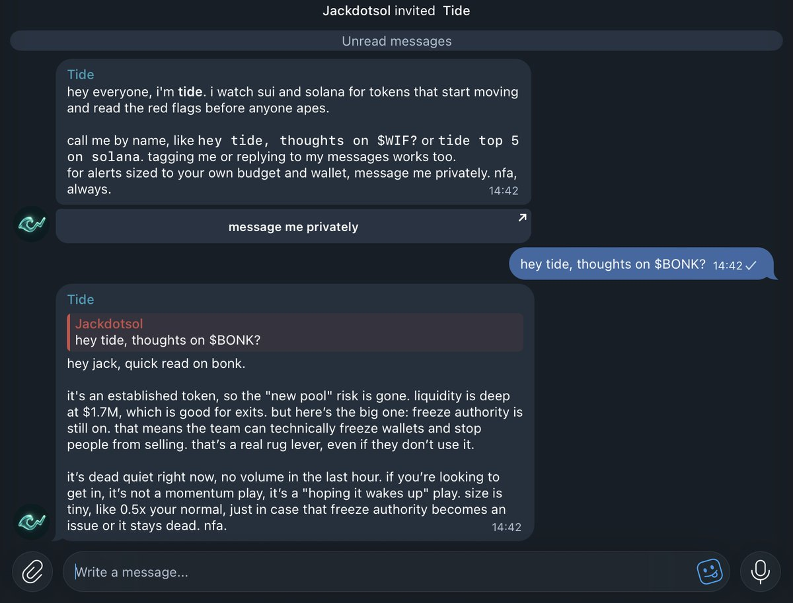
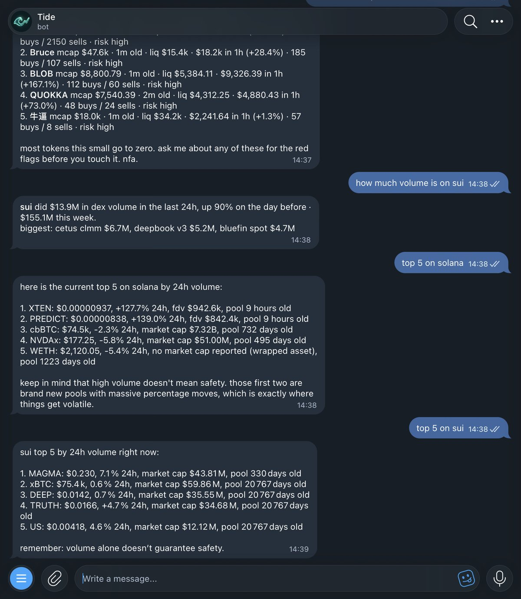
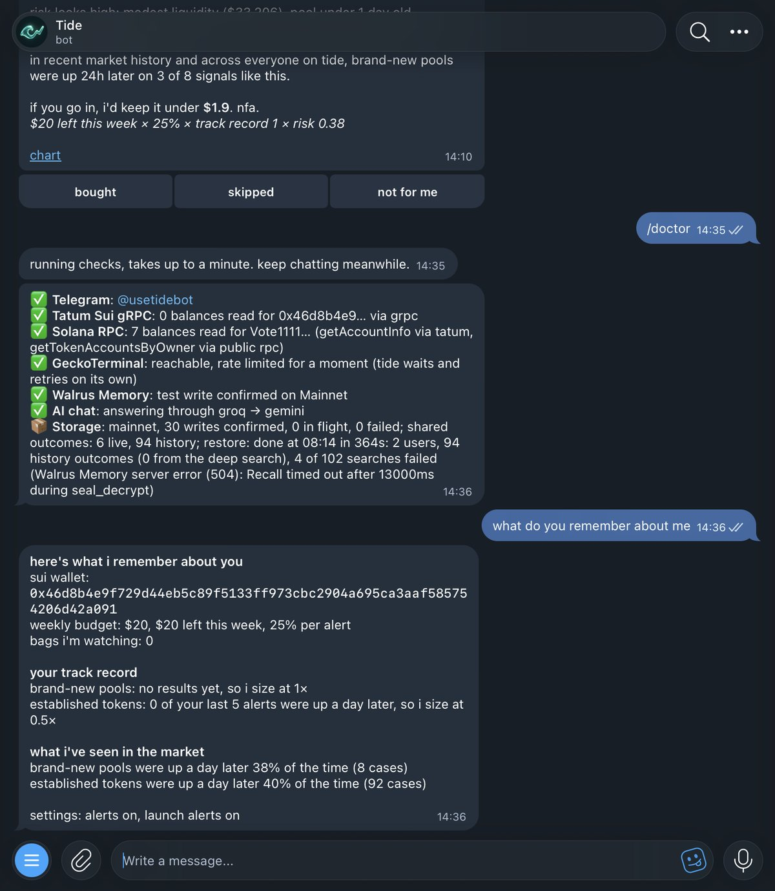
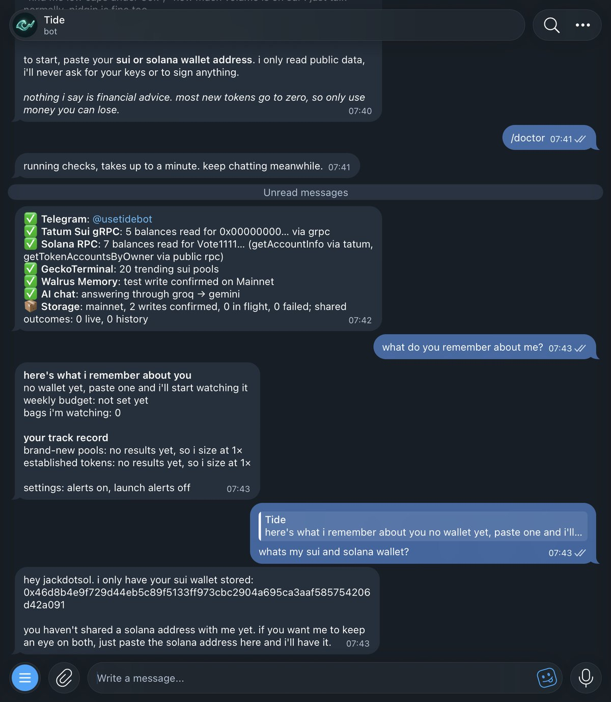

# Tide: a trading friend that remembers every call

*Built for the Walrus × Tatum "Total Recall" hackathon by Pascal Chukwu ([@jackdotsol](https://x.com/jackdotsol)).*


**Try it:** [t.me/usetidebot](https://t.me/usetidebot) · **Site:** [usetidebot.vercel.app](https://usetidebot.vercel.app) · **Code:** [github.com/not-a-vibe-coder/Tide](https://github.com/not-a-vibe-coder/Tide)

---

## The problem

Every memecoin trader knows the loop. A token starts moving, you see it late, you ape in without checking anything, it dumps, and a week later you do the exact same thing again. Not because you didn't learn, but because nothing you used remembered.

Alert bots are fast but forgetful. They shout about every pump, never tell you what could go wrong, and treat your tenth bad call exactly like your first. I wanted the opposite: something that watches the market with you, tells you the red flags first, and **gets stricter with you when your calls go bad**, because it actually remembers them.

That's Tide.

## What Tide does

Tide is a Telegram bot for Sui and Solana. You talk to it like a friend, in plain words (pidgin works too).



- **Finds tokens as they start moving.** Every 5 minutes it scans trending and brand-new pools on both chains and sends at most one pick per chain every 45 minutes: a real volume spike first, then a fresh launch if you opted in, otherwise the strongest steady climber.
- **Reads the red flags first.** Thin liquidity, pools that are hours old, more sellers than buyers, a valuation 100× bigger than the liquidity under it, buys coming from a handful of wallets, and on Solana, live **mint or freeze authority** read straight from the chain.
- **Tells you how much it would risk.** You set a weekly budget. Every alert comes with a maximum size, and the maths is shown: `budget left × share × your track record × risk`.
- **Remembers why you bought.** When a new token lands in your wallet, Tide asks why. Later it holds you to that reason and reports P&L against it.
- **Answers questions.** "why shouldn't i buy $BONK?", "top 5 on solana", "find me low caps under 50k", "how much volume is on sui".
- **Lets you set the rules.** "only send tokens under 100k mcap", "skip tokens already up 200%", "only solana alerts", "turn on launch alerts".



Look at the JLP alert above. The token has a $763M valuation and $1.8M of liquidity, mint and freeze authority are both still on, and 773 buys came from only 119 wallets. Tide still sends it, because it really is moving, but sizes it at **$0.62** out of a $20 week. The launch alert below it gets $1.90, because Tide has no bad results on launches from me yet.

It also works in group chats. Call it by name and it answers in the thread, but anything personal (wallets, bags, budget) gets moved to private.



## How Tide uses Tatum

All on-chain reads go through Tatum's RPC gateways.

**Sui, over gRPC.** Tide reads wallet balances through `sui-mainnet-grpc.gateway.tatum.io` using native gRPC (`@protobuf-ts/grpc-transport` on `@grpc/grpc-js`, with the API key in the `x-api-key` header). Every 30 minutes it snapshots each wallet, diffs it against the last snapshot, and anything new that wasn't paid for with a stablecoin becomes a buy. The first snapshot is only a baseline, so you never get asked about coins you already held. If gRPC ever fails, it falls back to Tatum's Sui JSON-RPC.

**Solana, over JSON-RPC.** `solana-mainnet.gateway.tatum.io` gives Tide:

- `getAccountInfo` (jsonParsed) for SOL balances and for **token safety**: whether the mint authority and freeze authority are still live, Token-2022 extensions, and transfer fees
- `getTokenAccountsByOwner` for SPL and Token-2022 balances
- `getTokenLargestAccounts` for holder concentration (how much the top wallet and the next 10 own)

Those safety reads feed straight into the risk multiplier. That's how Tide caught that BONK's freeze authority is still on.

One thing I learned: Tatum's free plan blocks `getBalance` on Solana. Instead of failing, Tide tries Tatum first for every method, remembers which ones are blocked for six hours, and only sends those to the public RPC. `/doctor` shows exactly which method went where.

Market data (prices, volume, pool ages) comes from GeckoTerminal, and whole-chain DEX volume comes from DefiLlama.



## How Tide uses Walrus Memory

Tide's memory **is** Walrus. Everything Tide knows about you is written to Walrus Memory on Mainnet as an append-only log of events:

| Event | What it records |
|---|---|
| `profile_set` | wallets, weekly budget, share per alert |
| `buy_detected` | a new token in your wallet, with cost and the price at the time |
| `buy_reason` | why you said you bought it |
| `alert_sent` / `alert_action` | each alert, and whether you bought, skipped or muted it |
| `alert_outcome` | where that token was 24 hours later |
| `preference` | your rules: mcap range, pump limit, chains, launches |
| `token_outcome` | shared market memory: how signals like this played out |
| `user_joined` | the registry of who uses Tide |

Each event is stored as a short readable line plus its JSON, for example `[tide:buy_reason] User 42 bought SCOOP because "dex volume rising" ⟨tide⟩ {…}`. Every user gets their own namespace (`tide-user-<id>`), and there's one shared namespace (`tide-tokens`) for market outcomes everyone learns from. Writes use the event ID as the idempotency key, so retries never create duplicates.

Tide uses Walrus in three ways:

1. **As the source of truth.** The bot also keeps a local SQLite cache for speed, but that cache can be thrown away. On startup, Tide pulls every user's events back from Walrus and replays them in time order.
2. **For semantic recall in chat.** When you ask something, Tide recalls the memories closest to what you said and gives them to the model, the same way a friend remembers what you told them last week.
3. **As shared learning.** Every 24-hour outcome goes into the shared namespace, so each new user starts from what the market already taught Tide instead of from zero.

Users never see any of this. Tide just remembers, like a person does.

## How Tide learned over time

This is the part I'm proudest of, because the learning is visible in every alert.

**Day zero: learning from history.** A new bot has no track record, so I made Tide replay the past. It pulls hourly candles for the most active pools on each chain, runs its own spike and launch rules over them, and checks where each signal was 24 hours later. The first run on Sui found 72 signals, and **only 31% were up a day later**. On Solana it found 66, and **41% were up**. That's a sobering number, and it's exactly why Tide sizes small by default. Each result is saved to the shared memory on Walrus.

**Then it learns from everyone.** Every live alert gets checked 24 hours later and joins the same shared memory. Today that memory says established tokens were up a day later on 37 of 92 signals (40%), and brand-new pools on 3 of 8. Every alert quotes this, so you always know the odds Tide is working with.

**Then it learns from you.** Once you have 5 results of your own in a class of token, your own record takes over:

```
track record = 0.5 + 0.7 × (your win rate over your last 10)
```

Before that, it uses the market's record, softened halfway towards 1 so a thin history can't swing too hard.

Here's what that looks like in practice. My first five alerts on established tokens were all down a day later. So Tide now sizes my established-token alerts at **0.5×**. Brand-new pools have no results from me yet, so they stay at **1×**. Nobody configured that; it learned it from my own calls.



## The day the server forgot (and Walrus didn't)

Tide runs on Render's free plan, which wipes the server's disk on every deploy. I shipped about fifteen deploys on the last day, and each one gave Tide amnesia. This turned out to be the best real test of the "Total Recall" idea.

- **First problem:** after a deploy the bot had no users, so it stopped sending alerts. Fix: on startup, restore everyone from Walrus, using a shared `user_joined` registry to know whose namespaces to read.
- **Second problem:** I sent `/start` a minute after a deploy, before the restore ran. That created a fresh empty profile, and the restore skipped me because it saw a user already. But when I asked the bot for my wallet, it still answered correctly, because the chat recalls straight from Walrus:



  Fix: the restore now always runs, and merges whatever happened since boot with the history on Walrus, latest change wins.
- **Third problem:** Walrus recall returns at most 100 results per search, so big namespaces came back partly. And firing 20 searches at once sometimes made recall time out during decryption (`504 … during seal_decrypt`). Fix: a two-phase restore. Phase one brings every user back fast with one search per event type, two at a time with a time limit each. Phase two digs past the cap in the background. `/doctor` now reports exactly how the restore went.
- **Bonus:** after a wipe, re-sending old events made Walrus answer `409 idempotency_key was already used`. That's Walrus confirming the memory was already there, so Tide now counts it as stored.

After all that: deploy, wipe the disk, and Tide comes back knowing my wallet, my $20 budget, my launch alerts, my bad calls, and what the market taught it.

## What's next

- A web version (the landing page says "coming soon" for a reason)
- Faster launch detection, so alerts land in the first minutes
- More chains, and tracking sells as well as buys

## Links

- Bot: [t.me/usetidebot](https://t.me/usetidebot)
- Website: [usetidebot.vercel.app](https://usetidebot.vercel.app)
- Code: [github.com/not-a-vibe-coder/Tide](https://github.com/not-a-vibe-coder/Tide)
- Built with [Walrus Memory](https://www.walrus.xyz) and [Tatum](https://tatum.io)

*Nothing Tide says is financial advice. Most new tokens go to zero. Only use money you can lose.*
